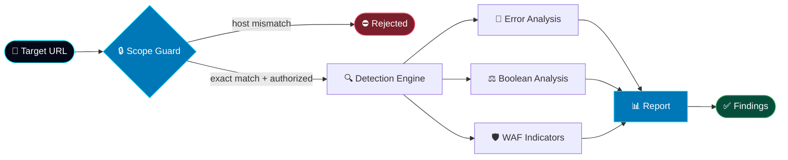

<div align="center">


<a href="https://github.com/Kichu-10/SQLSentinel">
  
</a>

<br/>


<br/>

**A powerful Python-based framework for authorized SQL injection security auditing.**

[**About**](#-about) •
[**Features**](#-core-capabilities) •
[**Preview**](#-live-preview) •
[**Install**](#-installation) •
[**Usage**](#-usage) •
[**Tests**](#-tests) •
[**Ethics**](#-ethical-use)

</div>

---

## 🧬 About

**SQLSentinel** is an advanced Python-based CLI framework engineered for **ethical hackers, penetration testers, and security researchers**.

It streamlines SQL injection auditing through automated vulnerability detection, database error analysis, boolean-based response comparison, WAF indicators, and professional security reporting, all behind strict scope and authorization checks.

> [!IMPORTANT]
> SQLSentinel refuses to run until you confirm written authorization and an **exact hostname match**. Safety is built into the workflow, not bolted on.

---

## ⚡ Core Capabilities

<div align="center">

| | Module | Description |
|:-:|:--|:--|
| 🔍 | **Detection Engine** | Automated SQL injection assessment |
| 🧠 | **Error Analysis** | Database error identification |
| ⚖️ | **Boolean Analysis** | Response behavior comparison |
| 🛡️ | **WAF Intelligence** | WAF presence indicators |
| 📊 | **Reporting Engine** | Structured security reports (JSON) |
| 💻 | **CLI Interface** | Interactive terminal workflow and dashboard |
| 🔒 | **Scope Guard** | Exact host matching and authorization prompts |

</div>

---

## 🔄 How It Works



---

## 🖥️ Live Preview

### Interactive dashboard

Run `sqlsentinel dashboard` and answer the guided prompts. The scope guard validates everything before a single request is sent.

<div align="center">


<sub>The dashboard enforces the exact hostname match. Here the scope was entered as a path, so the scan is safely rejected.</sub>

</div>

> [!TIP]
> The **scope hostname** is just the host, with no scheme and no path.
> ✅ `example.com`  ❌ `https://example.com`  ❌ `/admin`

### Startup banner

```text
┌──────────────────────────────────────────────┐
│                                              │
│   ███████╗ ██████╗ ██╗      ███████╗         │
│   ██╔════╝██╔═══██╗██║      ██╔════╝         │
│   ███████╗██║   ██║██║      ███████╗         │
│   ╚════██║██║▄▄ ██║██║      ╚════██║         │
│   ███████║╚██████╔╝███████╗ ███████║         │
│   ╚══════╝ ╚══▀▀═╝ ╚══════╝ ╚══════╝         │
│                                              │
│             SQL SENTINEL                     │
│       SQL INJECTION AUDITING FRAMEWORK       │
│                                              │
└──────────────────────────────────────────────┘
[+] Initializing SQLSentinel...
[+] Loading detection modules...
[+] Security engine ready.
[*] Awaiting authorized target...
```

---

## ⚙️ Installation

> **Requires Python 3.10 or newer.**

```shell
git clone https://github.com/Kichu-10/SQLSentinel.git
cd SQLSentinel
python -m pip install .
```

---

## 🚀 Usage

### 1️⃣ Explore the CLI

```shell
sqlsentinel --help
sqlsentinel version
```

### 2️⃣ Launch the guided dashboard

```shell
sqlsentinel dashboard
```

### 3️⃣ Inspect a URL (no request is sent)

```shell
sqlsentinel inspect-url "https://example.com/products?id=1&category=books"
```

### 4️⃣ Run a scoped scan

Replace the example URL and hostname with the **exact target covered by your written authorization**:

```shell
sqlsentinel scan "https://app.example.com/products?id=1" \
  --scope-host app.example.com \
  --authorized \
  --allow-public-target \
  --max-requests 12 \
  --delay 1 \
  --timeout 8 \
  --output reports/report.json \
  --format json
```

<details>
<summary><b>📖 Option reference</b></summary>

<br/>

| Option | Purpose |
|:--|:--|
| `--scope-host` | Must match the URL's hostname **exactly** (no scheme or path) |
| `--authorized` | Confirms you hold written authorization for this target |
| `--allow-public-target` | Required for public hosts. Omit for private or local targets |
| `--max-requests` | Hard cap on requests sent |
| `--delay` | Seconds to wait between requests |
| `--timeout` | Per-request timeout in seconds |
| `--output` | Where the report is written |
| `--format` | Report format (e.g. `json`) |

Run `sqlsentinel scan --help` for all options.

</details>

> [!NOTE]
> The scanner is **bounded and non-destructive**. It does not extract database contents or write to the target.

---

## 🧪 Tests

Install the dev dependencies and run the suite from the repository root:

```shell
python -m pip install -e ".[dev]"
python -m pytest -q
```

See the documentation for supported commands and authorized testing workflows.

---

## 🏗️ Project Philosophy

<div align="center">

> *Security isn't about finding weaknesses alone.*
> *It's about understanding them, documenting them, and fixing them.*

</div>

---

## 🔐 Ethical Use

SQLSentinel is developed **exclusively** for:

- ✅ Authorized penetration testing
- ✅ Personal security labs
- ✅ Educational research
- ✅ Defensive security assessments

> [!CAUTION]
> **Never test systems without explicit written authorization.** Unauthorized testing may be illegal. You are solely responsible for how you use this tool.

---

<div align="center">

### ⚡ SQLSentinel

**BUILT FOR SECURITY. DESIGNED FOR PRECISION.**


</div>
